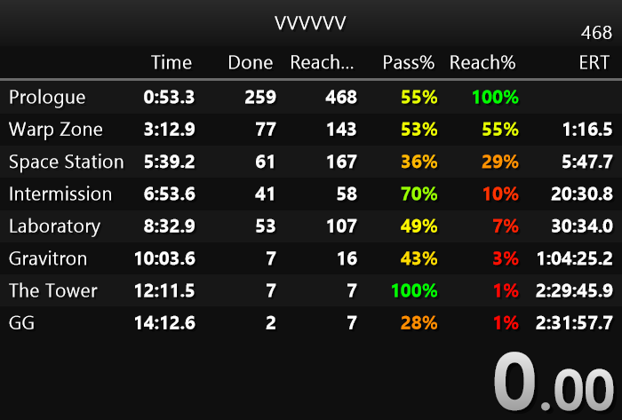

# LiveSplit.Splits

Splits component for LiveSplit with extra column types.

# Installation
1. Download `LiveSplit.Splits.dll` from releases.
2. Move it to `C:\Program Files (x86)\LiveSplit\Components` (or the `Components` folder of your LiveSplit installation).

# Usage
## Columns
| Column type | Shows |
| --- | --- |
| Completed | How many times the split has been completed (skipped splits count as completed) |
| Reached | How many times the split has been reached |
| Passrate | Completed / reached |
| Reachrate | Chance to reach the split: the passrates of all splits before it multiplied together |
| Estimated Reaching Time | Estimated average playtime needed to reach the split, calculated from passrates and mean split times |

The running attempt only counts for splits it has already passed, so arriving at a split does not lower its passrate. It counts for the split it is on only once you reset there.

Counts are tracked per split, so reordering, inserting, removing or renaming splits does not break the rates.

## Coloring
For the Passrate and Reachrate column types, enable **Color by rate** in the column settings. Color changes from red at 0% to yellow at 50% to green at 100%.

Layouts from earlier versions keep working: setting the column timing method to Game Time also enables coloring.

# Opening layouts without this component
Layouts with the extra column types don't open in the stock Splits component. Run `SplitsFixer.exe` from releases and select the layout (`.lsl`): it removes those columns and keeps the original as `.lsl.bak`. Splits files (`.lss`) are not touched, so their stats are kept.

# Where the counts are stored
Counts are saved in the splits file (`.lss`) as one permanent run variable named `SplitsReachStats`, keyed by split name.
- Splits files without it are recalculated from the segment history when opened, and the variable is written on the next save
- LiveSplit without this component ignores the variable; attempts made that way are added the next time the file is opened with it
- A renamed split is matched again by its segment history; a newly added split starts at 0
- Clearing the history in the splits editor clears the stats

# Building
Requirements:
- [.NET 8.0 SDK](https://dotnet.microsoft.com/en-us/download/dotnet/8.0)
- [.NET Framework 4.8.1 Developer Pack](https://dotnet.microsoft.com/en-us/download/dotnet-framework/thank-you/net481-developer-pack-offline-installer)

Run `build.bat [-c] [-i] [-r] [-n] [-h]`. Flags combine in any order, e.g. `build.bat -cir`. Replace the files in `lib\` with the ones from your LiveSplit installation if needed.

| Flag | Action |
| --- | --- |
| `-c` | Clean: delete previous build output first |
| `-i` | Install: copy `LiveSplit.Splits.dll` to `C:\Program Files (x86)\LiveSplit\Components` (may need administrator rights) |
| `-r` | Release: package `LiveSplit.Splits.dll` and `SplitsFixer.exe` into `release\` |
| `-n` | Nobuild: skip the build, reuse existing output (needs `-i` and/or `-r`, not with `-c`) |
| `-h` | Show this help |

Build output: `artifacts\bin\LiveSplit.Splits\release\LiveSplit.Splits.dll` and `artifacts\bin\SplitsFixer\release\SplitsFixer.exe`

# License
- [MIT](LICENSE.md)
- LiveSplit (MIT)
